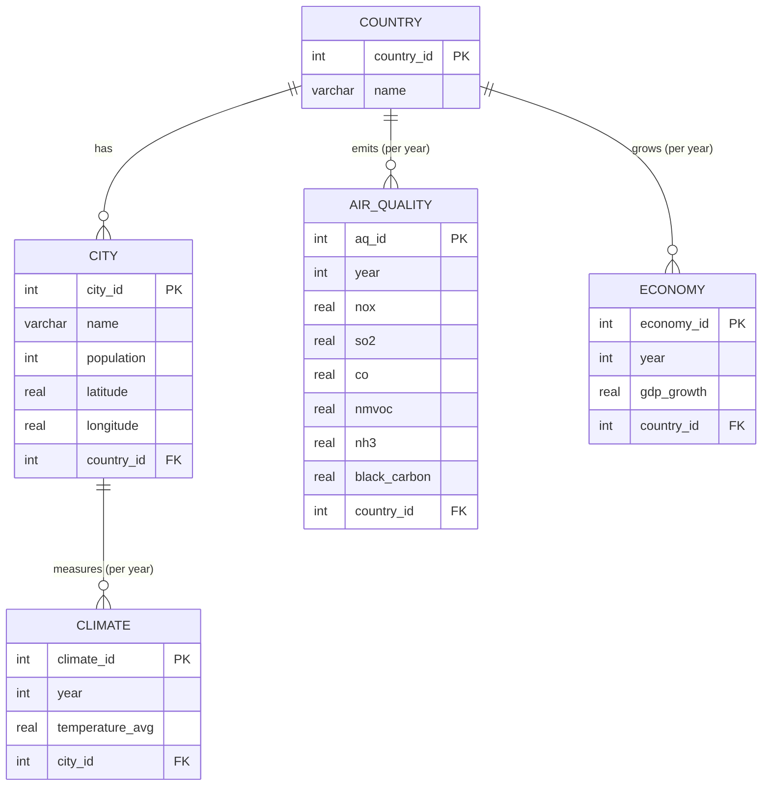

# Environment & Economy Database

A PostgreSQL database that brings together four public datasets about the world:
cities, temperatures, air pollution and GDP. Python scripts take the raw CSV files,
clean them, load them into 5 linked tables, and run SQL queries that mix the topics
(for example: did the countries that grew fastest also pollute more?).

Course project for *Databases 1*, M1 Data Science (Université de Lille / Centrale Lille),
made with Georges Moussa in December 2025. Cleaned up and improved afterwards.

**In short:** Python (pandas, SQLAlchemy), PostgreSQL, SQL, Docker, pytest.

## What the data shows

**Growing fast doesn't have to mean polluting more.** Among big emitters, South Korea grew
6.7% a year (GDP per capita, 1981-2010) and still cut its SO2 emissions by 73%. China grew
at about the same speed and its SO2 went up by 161%. ([query 10](sql/queries.sql))

| Country | GDP growth / year | SO2 change 1980 → 2010 |
|---|---|---|
| Egypt | 6.9% | +123% |
| South Korea | 6.7% | **−73%** |
| China | 6.3% | +161% |
| Laos | 5.6% | +794% |
| Argentina | 5.3% | −26% |

**The north and the middle of the continents warmed the most.** Average temperature in
2000-2012 compared to 1950-1962, for countries with at least 5 cities: Kazakhstan +1.5 °C,
Iran +1.4 °C, Russia +1.3 °C, then Eastern and Northern Europe at about +1.1 °C. ([query 9](sql/queries.sql))

**Some source values can't be trusted.** The GDP file gives the Turks and Caicos Islands a
+1205% growth in one year. Ranked by average growth, it would be the fastest economy in the world,
so query 3 ranks by the median instead (Singapore comes first, 8.1% a year).

All 10 queries and their full results are in [`results/`](results/).

## The database



Each measure is stored at the level where it exists in the data: pollution and GDP are per country,
temperature is per city. Country is the hub that links everything. The yearly measures are in their
own tables instead of columns of `country` or `city`, otherwise the country name would be repeated
for every year. A `UNIQUE (country_id, year)` constraint (or `city_id, year`) makes sure there is only
one value per place and year.

## The data

| Dataset | Rows | Used for |
|---|---|---|
| [World Cities](https://www.kaggle.com/datasets/juanmah/world-cities) | 48k cities | country, city |
| [Earth Surface Temperature](https://www.kaggle.com/datasets/berkeleyearth/climate-change-earth-surface-temperature-data) (`GlobalLandTemperaturesByCity.csv`) | 8.6M monthly values | climate |
| [Emission of Air Pollutants](https://www.kaggle.com/datasets/elmoallistair/emmision-of-air-pollutants?select=air-pollution.csv) | 47k country-years | air_quality |
| [World GDP Growth](https://www.kaggle.com/datasets/imtkaggleteam/world-gdp-economic-growth?select=1-+gdp-per-capita-penn-world-table.csv) (Penn World Table) | 10k country-years | economy |

We keep **1950 to 2013**, the years covered by all four files (temperatures stop in 2013,
GDP starts in 1950).

## How the pipeline works

```
data/raw/*.csv  →  etl/clean.py  →  data/clean/*.csv  →  etl/load.py  →  PostgreSQL  →  etl/run_queries.py  →  results/
```

1. **Inspect** (`etl/inspect_datasets.py`): shape, missing values and duplicates of each file.
2. **Clean** (`etl/clean.py`): one CSV per table.
   - Country names are translated to the World Cities spelling ("South Korea" → "Korea, South").
   - Missing temperatures (about 4% of the months) are dropped, not filled.
   - Missing city populations stay empty (NULL).
   - GDP growth is computed from GDP per capita, only between two consecutive years.
   - The 8.6M-row temperature file is read in chunks, so it runs on a laptop.
3. **Load** (`etl/load.py`): creates the schema from [`sql/schema.sql`](sql/schema.sql), empties the tables
   and inserts everything in batches of 1000 rows, in one transaction. Running it twice gives the same database.
   It prints what it skips, for example the regions like "World" or "Africa" in the pollution file.
4. **Query** (`etl/run_queries.py`): runs the 10 queries of [`sql/queries.sql`](sql/queries.sql) and saves the results.

## What I fixed after the course

Going back to the code later, I found bugs that silently lost or mixed data:

- **Countries lost because of spelling.** The datasets name countries differently
  ("Myanmar" / "Burma", "Democratic Republic of Congo" / "Congo (Kinshasa)"). The rows that didn't
  match were skipped without a word, so South Korea, Myanmar, both Congos, Côte d'Ivoire and more than 10
  others had no pollution or GDP data. A translation table now fixes this.
- **Cities with the same name were mixed.** Temperatures were averaged per city *name*, so Barcelona (Spain)
  and Barcelona (Venezuela) became one city. They are now grouped by city and country, and when several
  cities in one country share a name, the biggest one gets the climate data.
- **The schema wasn't always where we thought.** `SET search_path` was run on its own connection, and the
  next queries opened new connections, so unless the database user's default schema was already `project`,
  the tables went to `public`. The schema is now set on every connection.
- **Missing populations were stored as 0**, which pulled down every average. They are NULL now.
- **The pollutant names were wrong.** The source has nitrogen oxides (NOx), not NO2, and black carbon,
  not PM2.5. These are also yearly emissions in tonnes, not levels in the air. The columns now say so.
- **Running the scripts twice failed.** `CREATE SCHEMA` crashed the second time, and a typo in a
  `COMMENT ON TABLE` line stopped the table script. Everything now uses `IF NOT EXISTS` and loading is repeatable.
- The database password was hard-coded to the school server. It now comes from a `.env` file, with a
  Docker PostgreSQL to run everything locally.

## Run it

You need Python 3.10+ and Docker.

```bash
pip install -r requirements.txt
cp .env.example .env
docker compose up -d            # local PostgreSQL

# put the 4 CSV files from the links above in data/raw/
python -m etl.inspect_datasets
python -m etl.clean             # about 40 seconds
python -m etl.load              # about 30 seconds
python -m etl.run_queries

pytest                          # tests of the cleaning rules
```

## Files

```
etl/
    inspect_datasets.py   first look at the raw files
    clean.py              cleaning, one function per dataset
    load.py               schema + batch loading
    run_queries.py        runs sql/queries.sql, saves results/
    db.py, config.py      connection and paths
sql/
    schema.sql            the 5 tables, keys and constraints
    queries.sql           the 10 analysis queries
results/                  output of every query
tests/                    pytest tests
```
